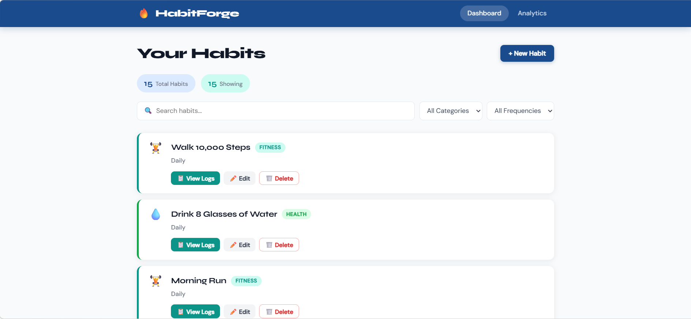

# HabitForge

**A full-stack habit tracker for building consistency: log completions, track streaks, and analyze progress over time.**

[**Live Demo**](https://habit-forge-final-project.onrender.com) · [Demo Video](https://youtu.be/UJ4qNQq3BXg) · [Design Document](./docs/design-document.pdf) · [Usability Report](./docs/usability-report.pdf)



> **Try it:** sign in with username `testuser` / password `password123`, or register a new account.
> The demo is hosted on Render's free tier, so the first load may take ~30 seconds while the server wakes up.

---

## Features

- **Habit management:** create, edit, and delete habits with daily or N-times-per-week targets, grouped by category
- **Completion logging:** log completions for today or past dates, with optional notes and quick-fill suggestions
- **Streaks:** current and longest streak per habit
- **Analytics:** weekly completion percentages, overall stats, and per-habit trends
- **Filtering and sorting:** date-range presets (Today, Past Week, Past Month, This Year, or a custom range), plus sorting by completion rate, streak, or name
- **Goals:** weekly goal targets per habit
- **Authentication:** session-based login with hashed passwords; each user only sees their own data

## Tech Stack

| Layer    | Technology                                                    |
| -------- | ------------------------------------------------------------- |
| Frontend | React 18 (Hooks, Context API), React Router v6, Vite          |
| Backend  | Node.js, Express                                              |
| Database | MongoDB (native Node.js driver)                               |
| Auth     | Passport.js (local strategy), bcrypt, express-session stored in MongoDB (connect-mongo) |
| Tooling  | ESLint, Prettier                                              |
| Hosting  | Render (Express serves the API and the built React app)       |

## Accessibility and Usability

- **100 Lighthouse accessibility score.** Full keyboard navigation, a skip-to-content link, labeled form inputs, ARIA roles, and accessible color contrast.
- **Usability-tested.** A usability study with real participants shaped several features, such as the date-range presets and quick-fill log notes. The study and the decisions that came out of it are documented in the [usability report](./docs/usability-report.pdf).
- **Consistent design system.** Syne for headings and DM Sans for body text. Color is used consistently by meaning: blue/teal for confirm actions, gray for cancel, red for destructive actions.

| Color     | Hex       | Usage                       |
| --------- | --------- | --------------------------- |
| Navy Blue | `#1a4b8c` | Primary actions, navigation |
| Teal      | `#0d9488` | Secondary actions, streaks  |
| Orange    | `#ea580c` | Goals, highlights           |
| Red       | `#dc2626` | Destructive actions         |
| Green     | `#16a34a` | Success states              |

## Architecture

```text
React SPA ──/api/*──▶ Express + Passport ──▶ MongoDB
                                             (users, habits, logs, goals, sessions)
```

In production, a single Express server serves both the REST API and the built React app. In development, Vite proxies `/api` requests to the backend.

### REST API

All routes except `/api/auth/*` and `/api/health` require an authenticated session.

| Resource  | Endpoints                                                                                     |
| --------- | --------------------------------------------------------------------------------------------- |
| Auth      | `POST /api/auth/register`, `POST /api/auth/login`, `POST /api/auth/logout`, `GET /api/auth/me` |
| Habits    | `GET/POST /api/habits`, `GET/PUT/DELETE /api/habits/:id`                                      |
| Logs      | `GET /api/logs/:habitId`, `POST /api/logs`, `DELETE /api/logs/:id`                            |
| Goals     | `GET/POST /api/goals`, `GET /api/goals/:habitId`, `PUT/DELETE /api/goals/:id`                 |
| Analytics | `GET /api/analytics/summary`, `GET /api/analytics/{streak,weekly,range}/:habitId`             |

## Running Locally

**Prerequisites:** Node.js 18+ and a MongoDB connection string (MongoDB Atlas or a local instance).

```bash
git clone https://github.com/aniketnandi/Habit-Forge.git
cd Habit-Forge

# Backend
cd backend
npm install
cp .env.example .env      # then set MONGO_URI and SESSION_SECRET
npm run seed              # optional: creates the test user and 1,000+ sample log entries
npm run dev               # API on http://localhost:5000

# Frontend (in a second terminal)
cd frontend
npm install
npm run dev               # app on http://localhost:5173
```

To run the production build locally, run `npm run build` in `frontend/`, then `npm start` in `backend/`. Express then serves the app at `http://localhost:5000`.

## Project Structure

```text
Habit-Forge/
├── backend/
│   ├── db/            # MongoDB connection, Passport config, seed script
│   ├── middleware/    # requireAuth
│   ├── routes/        # auth, habits, logs, goals, analytics
│   └── server.js
├── frontend/
│   └── src/
│       ├── components/  # Dashboard, HabitCard, HabitForm, LogView, Analytics, ...
│       ├── context/     # UserContext (auth state)
│       ├── api.js
│       └── App.jsx
└── docs/              # Design document, usability report, presentations, screenshots
```

## Authors

Built by **[Aniket Nandi](https://github.com/aniketnandi)** and **Runze (Neil) Wang** for CS 5610 Web Development at Northeastern University.

- **Aniket:** habits (full CRUD), completion logs, registration
- **Neil:** goals (full CRUD), analytics, login/logout

## License

[MIT](./LICENSE)
